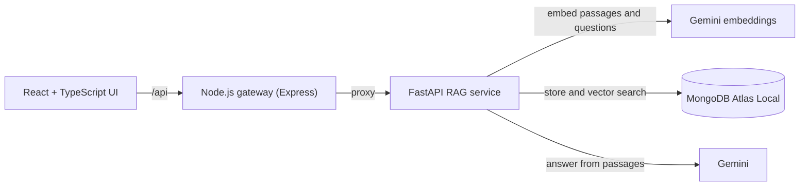

# RAG Document Q&A

[](https://github.com/jedi-ani/ai-rag/actions/workflows/ci.yml)


Upload PDF, Markdown or text documents, then ask questions about them. Answers are written by **Gemini** from the most relevant passages, found with **MongoDB vector search**, and every claim is cited as `[1]`, `[2]`, ... and linked back to the exact passage and page it came from.

The stack is a **Python (FastAPI)** RAG service, a **Node.js (Express, TypeScript)** gateway and a **React (TypeScript)** interface.

## Features

- **Cited answers.** Each answer marks its claims with `[n]`. The UI turns those markers into links to the source passage, with filename, page number and a match score.
- **Citations are checked.** If the model cites a source that was never retrieved, the response flags it as an `invalid_citation` instead of trusting it.
- **Says "I don't know".** When the documents do not contain the answer, the model is instructed to say so, and the UI marks the answer as not grounded.
- **PDF, Markdown and text.** PDF passages keep their page numbers.
- **Vector search in MongoDB.** Embeddings are stored with each passage and indexed with an Atlas Vector Search index (cosine similarity), with an optional per-document filter.
- **Idempotent uploads.** Documents are identified by a hash of their content, so uploading the same file again replaces it instead of duplicating it.
- **Timings on every answer.** The API and UI show embed, search and generate times separately.
- **Measurable.** Scripts measure latency against document size and answer fidelity across temperatures (see [Evaluation](#evaluation)).

## Architecture



**Ingest:** file → pages → paragraph-aware chunks (1200 characters, 150 overlap, never across pages) → embeddings → MongoDB.

**Ask:** question → embedding → `$vectorSearch` for the top passages → numbered prompt → Gemini → `[n]` markers parsed and validated → answer with citations and timings.

The gateway serves the built UI, proxies `/api/*` to the Python service, and adds security headers, a request-rate limit and an upload-size check.

## Quick start

You need Docker and a Gemini API key from [Google AI Studio](https://aistudio.google.com/).

```bash
git clone https://github.com/jedi-ani/ai-rag.git
cd ai-rag
cp .env.example .env     # then put your key in GEMINI_API_KEY
docker compose up --build
```

Open <http://localhost:8080>, upload a file (try those in `sample_docs/`) and ask a question. The Python API docs are at <http://localhost:8000/docs>.

> The local MongoDB container does not keep data between `docker compose down` runs, so re-upload your documents after a restart.

### Development without Docker for the app

```bash
docker compose up mongo                      # MongoDB with vector search on localhost:27017

cd backend
python -m venv .venv && source .venv/bin/activate
pip install -r requirements-dev.txt
uvicorn app.main:create_app --factory --reload        # http://localhost:8000

cd ../frontend && npm install && npm run dev          # http://localhost:5173 (proxies /api to :8000)
```

## API

| Method | Path | Purpose |
|---|---|---|
| `POST` | `/documents` | Upload and index a file (multipart field `file`) |
| `GET` | `/documents` | List indexed documents |
| `DELETE` | `/documents/{doc_id}` | Delete a document and its passages |
| `POST` | `/ask` | Ask a question |
| `GET` | `/health` | Liveness check |

Through the gateway the same routes live under `/api` (for example `/api/ask`).

```bash
curl -s -X POST http://localhost:8000/ask \
  -H "Content-Type: application/json" \
  -d '{"question": "How many times does Lambda retry a failed asynchronous invocation?"}'
```

The response contains the `answer` text, a `grounded` flag, the `citations` the answer actually uses, every `retrieved` passage, any `invalid_citations`, and `timings` in milliseconds. Optional request fields: `top_k`, `temperature` and `doc_ids`.

## Configuration

Environment variables or a `.env` file (real environment variables win).

| Variable | Default | Description |
|---|---|---|
| `GEMINI_API_KEY` | required | Gemini API key |
| `GEMINI_MODEL` | `gemini-3.8-flash` | Answer model. Model names change over time, so override this if it is retired |
| `EMBEDDING_MODEL` | `gemini-embedding-001` | Text embedding model |
| `EMBEDDING_DIMS` | `768` | Embedding size. The vector index is created with this value |
| `CHUNK_CHARS` / `CHUNK_OVERLAP` | `1200` / `150` | Chunk size and overlap in characters |
| `TOP_K` | `5` | Passages retrieved per question |
| `MIN_SCORE` | `0` | Drop retrieved passages scoring below this (cosine, 0 to 1) |
| `MAX_UPLOAD_MB` | `20` | Upload limit (the gateway also enforces it) |
| `MONGODB_URI` / `MONGODB_DB` | local / `ragapp` | Database connection |

Gateway: `PORT` (8080), `BACKEND_URL`, `RATE_LIMIT_PER_MINUTE` (60), `MAX_UPLOAD_MB`, `PROXY_TIMEOUT_MS` (120000).

If you change `EMBEDDING_DIMS` or `EMBEDDING_MODEL` after indexing documents, delete the database and the `chunk_vector_index` index and re-upload, because old vectors no longer match.

## Evaluation

Two scripts in `backend/` measure the claims you would otherwise have to take on trust. They need MongoDB running and `GEMINI_API_KEY` set.

**Latency against document size**

```bash
cd backend
python -m scripts.benchmark --sizes-kb 20 200 1000
```

Builds synthetic documents of increasing size, uploads each one and reports ingest time plus the embed, search and generate time of a few questions. Earlier measurements by the author on a prototype ranged from about 0.9 s to 32 s end to end depending on document size. Run the script to see what your setup gives.

**Answer fidelity across temperatures**

```bash
python -m scripts.eval_temperature --temperatures 0 0.4 0.8 1.0 --repeats 3 --out results.csv
```

Asks 12 questions (10 answerable from `sample_docs/`, 2 that are not) at each temperature and reports, per temperature, how many answers contain the expected fact, how many cite a real passage with no invalid markers, how many unanswerable questions were correctly refused, median latency and how many distinct answers repeated runs produced.

> **Check your model honours temperature.** Google's Gemini API documentation says newer models (3.6 and later) ignore a custom temperature. If every temperature gives identical results, set `GEMINI_MODEL` to a model that supports the setting before drawing conclusions.

## Testing

```bash
cd backend && pip install -r requirements-dev.txt && pytest -q
cd gateway && npm install && npm test
cd frontend && npm install && npm run build   # type-checks and builds
```

The backend tests cover chunking, loaders (including a real PDF), embedding batching and retries, prompt building, citation parsing and validation, the RAG flow with fakes, and the MongoDB pipeline and index definition. No test calls Gemini or needs a database: model calls are injected and the vector store has an in-memory twin with the same interface. The gateway tests start a stub backend to check proxying, the upload limit and error handling.

## Design decisions

- **Chunk on structure, not just length.** Chunks follow paragraph and sentence boundaries, carry a short overlap, and never span pages, so a citation can name one page.
- **Cosine similarity on normalised vectors.** Embeddings are L2-normalised once, and the index uses cosine.
- **Retrieved text is untrusted.** Passages and questions are wrapped in delimiters, look-alike delimiters are stripped and the model is told never to follow instructions inside them.
- **Validate, don't trust.** Citation markers are parsed and checked against what was really retrieved.
- **Don't call the model with nothing to ground on.** If search returns no passages above `MIN_SCORE`, the service answers "not found" without a model call.
- **Wait for the index.** Atlas indexes new vectors shortly after insert, so an upload returns only once its passages are searchable. A question asked right after uploading therefore finds them.
- **A gateway in front.** The Node layer keeps the Python service off the public edge and applies rate and size limits in one place.

## Limitations

- **No authentication** and no per-user document separation. Put it behind a login or gateway before sharing it.
- **No OCR.** Scanned PDFs without a text layer are rejected.
- **Single-turn Q&A.** There is no conversation memory.
- **`gemini-embedding-001` accepts about 2,048 tokens per passage.** The default chunk size is well within that. Switching to a newer embedding model needs a code change, because its API differs.
- **Replacing a document is not atomic.** Re-uploading briefly removes the old passages before the new ones are searchable.
- **Local Atlas container is for development.** It has no persistent volume in the compose file.
- Answer quality has been checked only on the small sample set, not a large labelled dataset.

## Roadmap

- Authentication and per-user collections
- Streaming answers
- Persisting the vector database between restarts
- A larger labelled evaluation set and a report

## Project structure

```
backend/     FastAPI service: ingest, embeddings, store, generation, evaluation scripts, tests
gateway/     Node.js (Express, TypeScript) gateway and its tests
frontend/    React + TypeScript UI (Vite)
sample_docs/ Small documents for trying it out and for the evaluation
```

## Author

Built by [Anirban Dey](https://github.com/jedi-ani).

## License

MIT, see [LICENSE](LICENSE).
